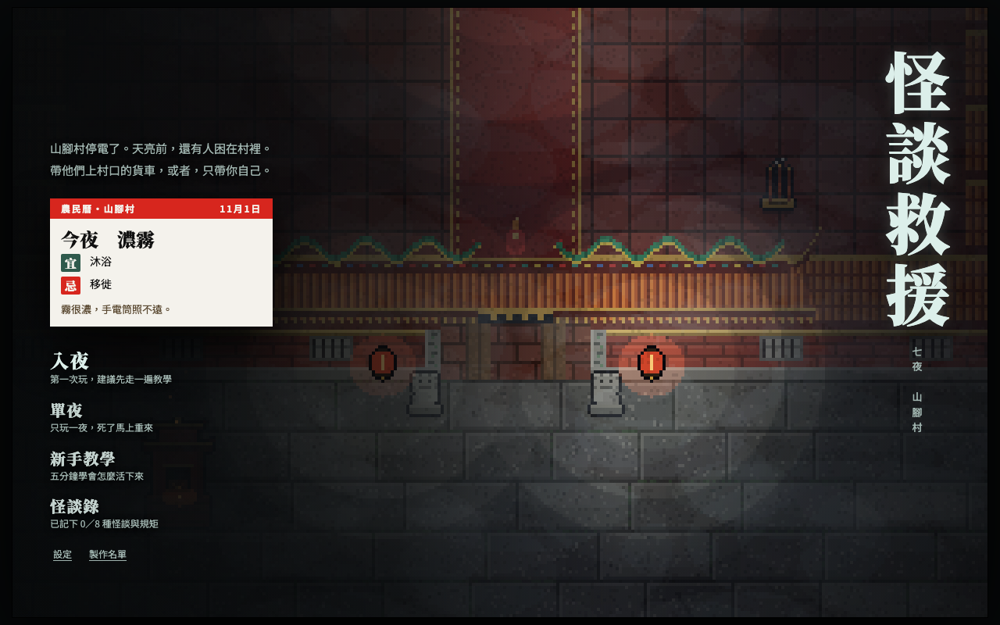
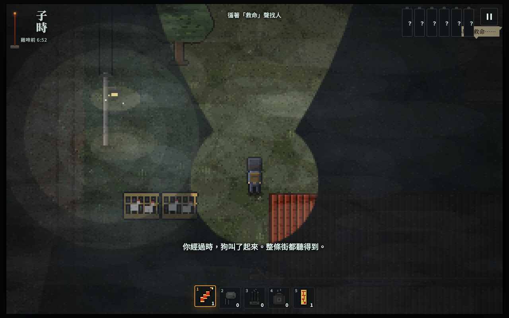

# Kaidan Rescue 怪談救援

**A browser horror game set in a Taiwanese village during a blackout: lead the villagers to the truck before the rooster crows, while monsters from Taiwanese folklore hunt you in the dark.**

台灣民俗怪談的網頁恐怖遊戲：停電的山腳村裡，天亮前把村民帶上村口的貨車。

> **Type** Personal project · **Status** In progress (playable prototype, 2026-10) · **Role** Solo project · **Stack** Single-file HTML, JavaScript, Canvas pixel art, Python + Playwright tests

**[Play in the browser](https://hunter20041004.github.io/kaidan-rescue/)** · desktop or phone, no install

## Background

Made for Taiwanese players who grew up with these stories (Grandaunt Tiger, Mosinna, the girl in red, the seventh-night return) and notice when they are told wrong. Survival depends on knowing the folk rules, such as holding your breath near a jiangshi or answering the slit-mouthed woman correctly, rather than fighting.

## What it does

- **Five folklore monsters** (Mosinna, Grandaunt Tiger, the slit-mouthed woman, jiangshi, water ghost), each with its own rule for staying alive, plus three "rule spirits" such as the girl in red and a midnight funeral procession.
- **Rescue under pressure**: find villagers by their cries, have them follow or wait, and get everyone to the truck before dawn.
- **Folk items and hiding spots**: firecrackers, maltose candy, incense, kerosene and talismans; hide in wardrobes, haystacks, trees or wells.
- **Night Road mode (夜路)**: walk the same village road to the wake three nights running. Each night the farmer's almanac changes what counts as normal (on a day marked "avoid weddings", a wedding at midnight is not a living one), and you must spot what is wrong and answer it the folk way: chant, freeze, step aside, or never look back.
- **Seven Nights mode**: each night is longer and harder; villagers you saved bring gifts, and the ones you lost may call your name from behind.
- **Runs anywhere**: one HTML file with touch controls for phones and keyboard controls for desktop.

## Key decisions

| Decision | Why |
| --- | --- |
| Survive by folk rules, not combat | The fear comes from knowing what you must not do, which is how these stories are told. |
| All pixel art drawn by code, no image files | Keeps the whole game in one small file and avoids art licensing questions. |
| One self-contained HTML file | Anyone can play from a link or a double-click, on desktop or phone. |
| Rule behaviour covered by automated browser tests | Each monster's rule must work exactly as the folklore says, or the game feels unfair. |

## Results

- Playable prototype with a tutorial, single-night mode, the seven-night campaign and the three-night Night Road.
- 82 automated rule tests for the rescue modes and 130 for Night Road, all passing in a real browser (for example: Grandaunt Tiger finds people hiding in a wardrobe; answering "ordinary" lets you escape the slit-mouthed woman).

## Run it locally

Open `index.html` in a browser. To rebuild it from `src/` after changes, run `./build.sh`. Tests need Python with Playwright: `./tests/run_all.sh`.

Development notes (Chinese): [`docs/DEVELOPMENT.md`](docs/DEVELOPMENT.md) · Art direction: [`docs/art-bible.md`](docs/art-bible.md)

## Notes

Sound effects are CC0 recordings from BigSoundBank; see [`audio/CREDITS.md`](audio/CREDITS.md). UI fonts load from Google Fonts; in-world text uses the pixel font Cubic 11 (俐方體11號, SIL Open Font License, [`fonts/OFL.txt`](fonts/OFL.txt)), embedded at build time.

## 中文摘要

以台灣民俗怪談為題材的網頁恐怖遊戲。停電的山腳村裡，玩家要在雞啼前把村民帶到村口的貨車；魔神仔、虎姑婆、裂口女、殭屍、水鬼各有一條活命規矩，還有紅衣小女孩、夜半送葬等規矩怪。可以躲衣櫃、草垛、樹上和井裡，用鞭炮、麥芽糖、線香等民俗道具脫身。整個遊戲是一個網頁檔，畫面全由程式即時畫出，手機和電腦都能玩。新模式「夜路」：連續三晚走同一條路去靈堂，農民曆的宜忌每晚改寫什麼叫正常，玩家要看出路上的不對勁，用念佛、站住、讓路、不回頭應對。救人模式 82 條、夜路 130 條自動化測試全部通過。
